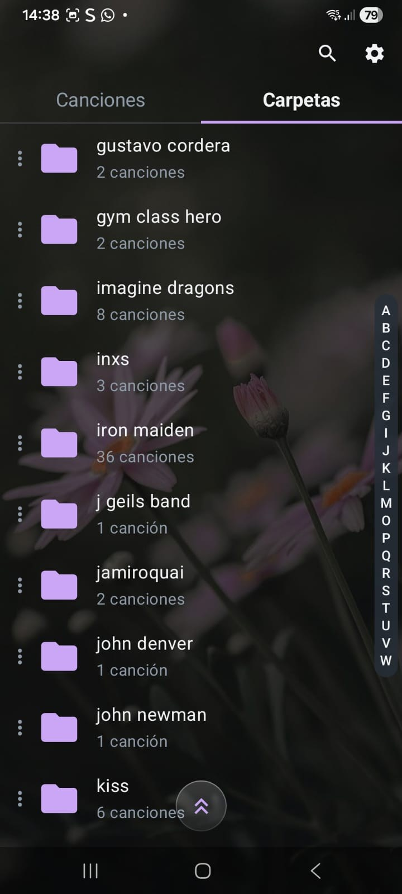
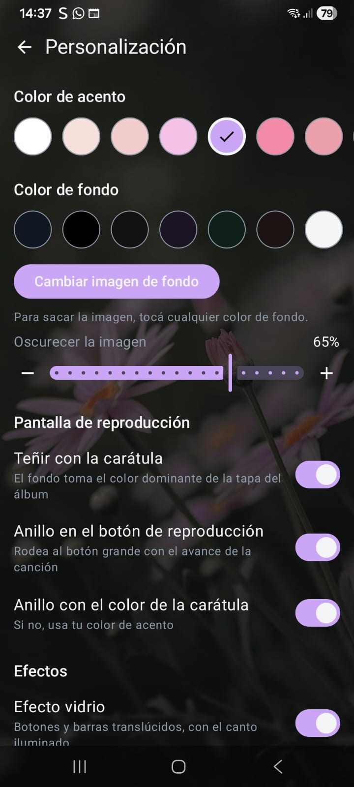

# Music Player

An Android music player for the audio files already on your phone. It browses your music by song or by folder, and plays it with lock-screen and notification controls.

<p align="center">
  
  &nbsp;&nbsp;
  
</p>

## Install

Download the latest `.apk` from [Releases](https://github.com/Maxi-Andres/music-player/releases) on your phone and open it. The first time, Android asks you to allow installing apps from that source. Requires Android 8.0 or later.

The app checks GitHub Releases for new versions, and updating keeps your settings.

## Features

- **Songs and folders:** browse every song on the device or navigate your folders, with search and an A–Z index to jump through long lists.
- **Sorting:** by title, artist, date added or duration.
- **Now playing:** big artwork, a progress bar with ±10 s skip buttons, shuffle and repeat, and the screen tinted with the colors of the current cover.
- **Queue:** build your own play queue, separate from the folder you're playing.
- **Equalizer.**
- **Background playback** with controls in the notification and on the lock screen.
- **Customization:** accent and background colors, a custom background image, and a glass effect for buttons and panels.

## Built with

Kotlin · Jetpack Compose (Material 3) · Media3 / ExoPlayer · Coil · Coroutines

The CI runs lint, unit tests with coverage checks, and UI tests on an emulator. Pushing a `vX.Y.Z` tag builds, signs and publishes the APK to Releases ([details](docs/publicar.md), in Spanish).

## Build from source

Open the project in Android Studio, or run:

```bash
./gradlew assembleDebug
```

The APK ends up in `app/build/outputs/apk/debug/`.
